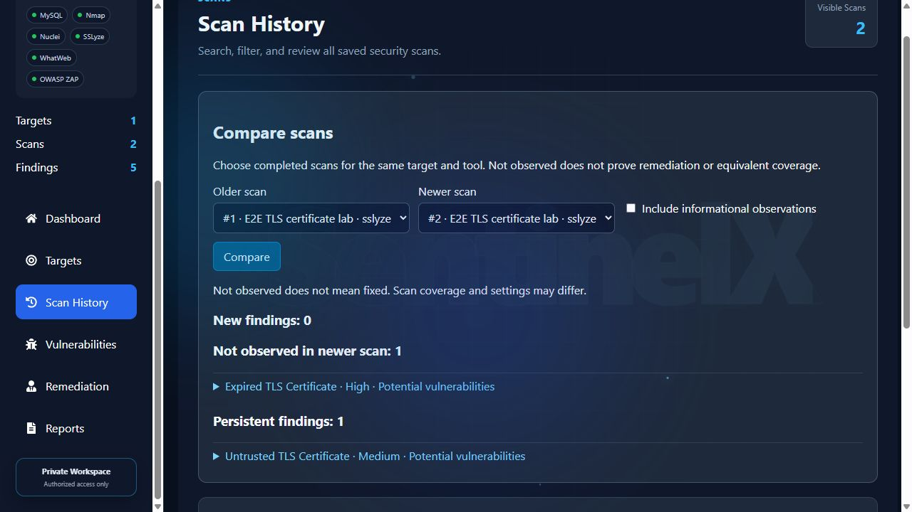
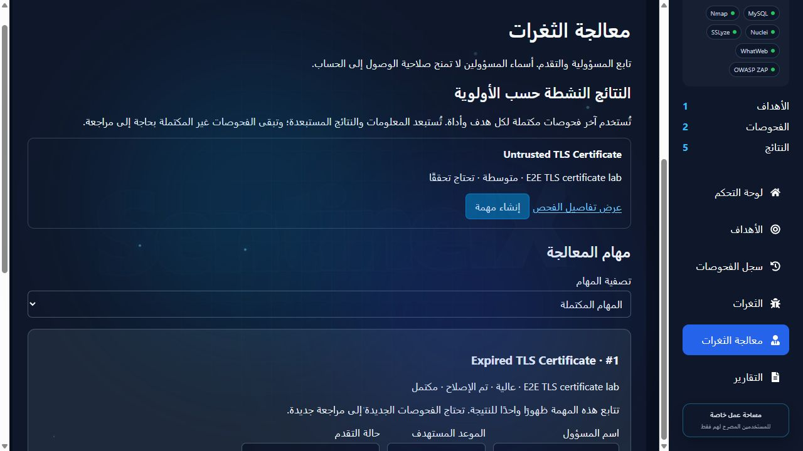

# SentinelX

[](https://github.com/ea9x/SentinelX/actions/workflows/checks.yml)

A local security assessment workspace for authorized analysts. SentinelX queues scans, retains evidence, groups findings, tracks manual review and remediation, compares completed scans, and exports PDF reports.

**Status: experimental, single-service/single-operator deployment.** Do not treat automated findings, a successful scan, or an empty result as proof that a target is secure. This repository is not a certified penetration-testing product or a public multi-tenant scanning service.

## Features

- React interface in English and Arabic, including right-to-left layout.
- Nmap, WhatWeb, OWASP ZAP, Nuclei and SSLyze integrations; scanner binaries are installed separately.
- Persistent serial scan queue, progress, cancellation, explicit partial/failed coverage and retained history.
- Owner-scoped targets, findings, reports and remediation tasks.
- Cookie-based JWT authentication with CSRF protection, session revocation and optional email-link password recovery.
- Manual finding review, revision history, conservative comparison and PDF reports.
- Local encrypted backups with isolated restore verification.

## Screenshots

These screenshots use a synthetic local TLS target and a disposable test account. They show real SSLyze observations in an isolated workflow; no customer targets or production findings are shown. The test database was SQLite; the historical sidebar's MySQL label identifies the integration and does not establish the fixture database engine.

### Compare scans

A controlled certificate replacement removes the expiration observation while the separate self-signed trust warning persists. An absent finding is shown as **not observed**, without automatically marking it fixed.



### Remediation in Arabic

The original occurrence was manually reviewed after the recheck, and its task was then marked completed. New scan occurrences require their own review.



## Supported starting point

The Windows installation path was rehearsed with Python 3.12, Node 24 and MySQL 8. Python 3.15 is not a supported fresh-install target. Start with [Windows installation](INSTALL-WINDOWS.md). [Docker](DOCKER-SETUP.md) is experimental and has not passed an end-to-end Docker build/run check in this release.

```powershell
py -3.12 -m venv backend\venv
backend\venv\Scripts\python.exe -m pip install -r backend\requirements.txt
npm ci --prefix frontend
py -3.12 scripts\configure_local.py
```

Create your dedicated MySQL database/user, enter the database password in the newly generated `backend/.env`, and install/configure the scanners. Match the generated ZAP API key in your ZAP service. Then create the first account locally:

```powershell
cd backend
venv\Scripts\python.exe -m flask --app app create-initial-admin
cd ..
npm run build --prefix frontend
.\start_local.ps1
```

Open `http://127.0.0.1:8088/login`. There are no shipped accounts or default passwords. Public registration is disabled by default. Login does not require SMTP; password recovery does.

## Tests

Backend tests use a disposable SQLite database and mocked scanner processes or local HTTP fixtures. They do not scan your saved targets or connect to your MySQL database. Run from `backend`:

```powershell
venv\Scripts\python.exe -B -m unittest discover -s tests
```

From the repository root:

```powershell
npm run test:i18n --prefix frontend
npm run build --prefix frontend
python scripts/check_release.py
```

The GitHub workflow runs these checks on Windows and Linux. A workflow file is not evidence of a successful hosted run; inspect the actual Actions results after pushing.

## Operational boundaries

The local launcher starts a background Windows backend supervisor. It restarts a backend only when port 5000 is closed; it never kills a process occupying that port. Interrupted scans are marked failed and require an explicit new scan. [Operations](docs/OPERATIONS.md) explains stopping supervision and troubleshooting.

Local HTTP serving uses Flask development serving and Vite preview. Keep it on loopback. TLS termination, Secure cookies, a production server, destination restrictions, scanner isolation, monitoring and independent review are required before internet deployment. Docker binds its frontend to loopback by default.

## Documentation

- [Web scans, accounts and coverage](WEB-SCAN-GUIDE.md)
- [Security policy](SECURITY.md) and [review scope](SECURITY-REVIEW.md)
- [Contributing](CONTRIBUTING.md)
- [Publishing checklist](docs/PUBLISHING.md)
- [Third-party components](THIRD_PARTY_NOTICES.md)
- [Draft v0.1.0 preview notes](docs/releases/v0.1.0.md)

## Rights and license

No open-source license has been selected for SentinelX yet. Public visibility does not grant a general license to use, modify or redistribute this project's original code. The owner must select a license before advertising it as open source. Third-party components retain their own licenses. Do not add a license to code you do not own.
